<p align="center">
  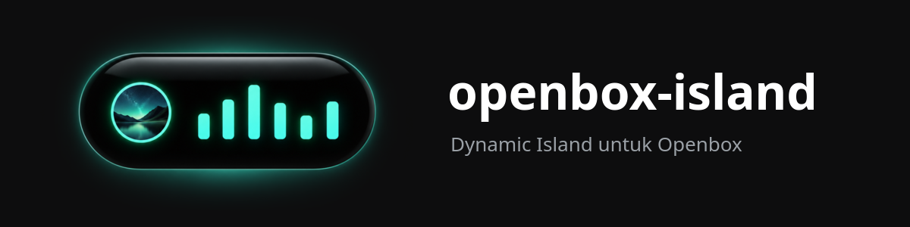
</p>

<p align="center">
  <strong>A Dynamic Island–style notch for Openbox, built with eww.</strong>
</p>

<p align="center">
  <a href="https://github.com/ardzz/openbox-island/actions/workflows/ci.yml"></a>
  <a href="LICENSE"></a>
  
  
  
  
  
  
</p>

<p align="center">
  <a href="#highlights">Features</a> ·
  <a href="#gallery">Gallery</a> ·
  <a href="#install">Install</a> ·
  <a href="#architecture">Architecture</a> ·
  <a href="#documentation">Docs</a>
</p>

<p align="center">
  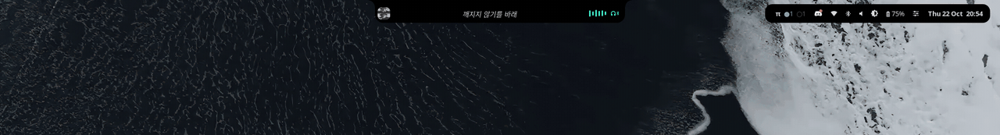
  <br>
  <sub>Running on a real Openbox desktop; background blurred for privacy.</sub>
</p>

<p align="center">
  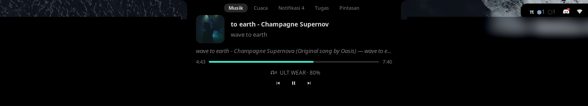
</p>

openbox-island sits at the top edge of monitor 0 like a notch: a 508×44 px compact pill that grows into a 508×218 px tabbed card. It shows what is playing, takes over dunst notifications, flashes short alerts for hardware and network changes, and keeps weather, a to-do list and shortcuts one hover away.

## Highlights

**Now playing**
- Follows MPRIS players in a configurable priority order (default `ytm_player,ytermusic,edge,%any`), with first-class support for YouTube Music through [ytm-player](https://ytm-player.com).
- Synced lyrics from LRCLIB with NetEase Cloud Music as a fallback; for ytm-player, YouTube Music lyrics are tried first.
- A real audio spectrum visualizer, processed at the island monitor's refresh rate and fed only by the active player's own output stream.
- Like/dislike buttons and an "up next" line for ytm-player.
- A grey skeleton keeps the music layout in place while the player switches tracks.
- Bluetooth or wired headphones show an icon on the pill, and the Music tab shows the device name and battery level.

**Notifications**
- Every dunst notification, critical ones included, appears in the island instead of a dunst popup; critical notifications get a red accent.
- Clicking a notification dismisses it and focuses or launches its app.
- A Notifications tab works as a notification center built on dunst history, and its label shows the unread count.

**Alerts**
- Temporary pill alerts for volume and mute, microphone, audio output switch, brightness, charging, battery (including Lenovo conservation mode), low battery, Wi-Fi, Bluetooth, VPN and Tailscale, new screenshots (with a thumbnail), CPU/GPU temperature, Caps Lock, and ACPI power profile.

**Tabs**
- The expanded card has **Music**, **Weather**, **Notifications**, **To-do** and **Shortcuts** tabs. Each tab appears only while it has content; To-do is always available.

**Indicators**
- Dots on the pill for screen recording (red, with elapsed time), microphone in use (yellow) and camera in use (green), plus a crossed-out bell while dunst Do Not Disturb is on.

**Smart behaviour**
- Hides while a fullscreen window covers the island's monitor.
- Expands after the pointer rests on it for 0.3 s.
- Expands for 4 s on track change, then collapses.
- Scrolling over the compact pill changes the default output volume by ±5%.

Full behaviour reference: [docs/fitur.md](docs/fitur.md) (Indonesian).

## Demo

<p align="center">
  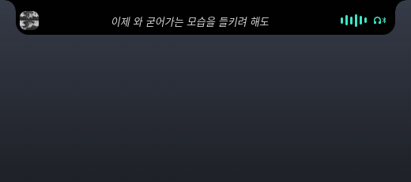
  <br>
  <sub>Rendered from sample data with <code>tools/showcase</code>: music pill, card tabs Music → Weather → Notifications → To-do → Shortcuts, a volume alert and an email from Linus Torvalds.</sub>
</p>

## Gallery

All images below are rendered from sample states in `tools/samples/`.

### Cards

<table>
  <tr><th colspan="2">Music</th></tr>
  <tr>
    <td align="center">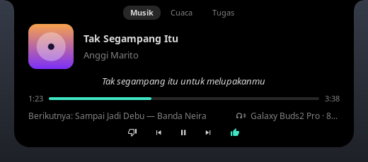<br><sub>YouTube Music: like/dislike and up next</sub></td>
    <td align="center">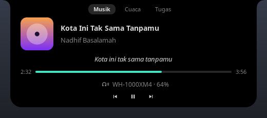<br><sub>Other MPRIS player</sub></td>
  </tr>
  <tr>
    <td align="center">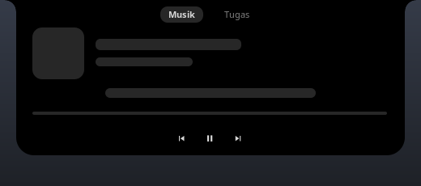<br><sub>Skeleton between tracks</sub></td>
    <td></td>
  </tr>
  <tr><th colspan="2">Weather</th></tr>
  <tr>
    <td align="center">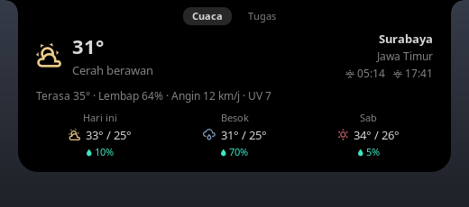<br><sub>Day</sub></td>
    <td align="center">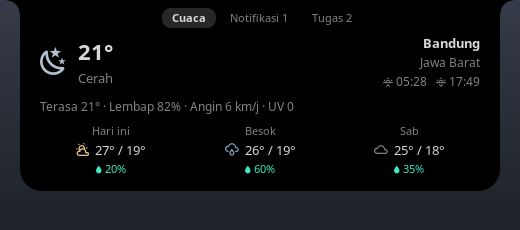<br><sub>Night</sub></td>
  </tr>
  <tr>
    <td align="center">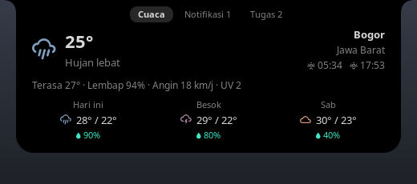<br><sub>Rain</sub></td>
    <td></td>
  </tr>
  <tr><th colspan="2">Notifications</th></tr>
  <tr>
    <td align="center">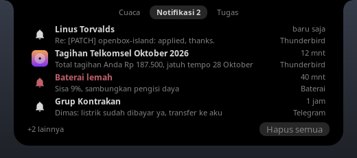<br><sub>Notification center</sub></td>
    <td align="center">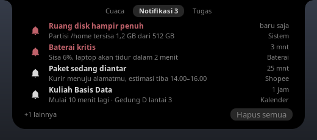<br><sub>Critical notification</sub></td>
  </tr>
  <tr>
    <td align="center">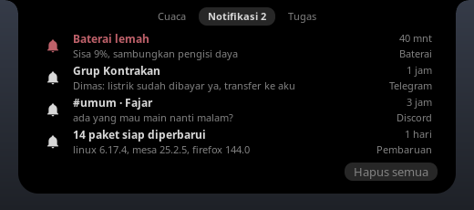<br><sub>Scrolled to older notifications</sub></td>
    <td></td>
  </tr>
  <tr><th colspan="2">To-do</th></tr>
  <tr>
    <td align="center">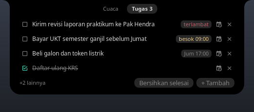<br><sub>List</sub></td>
    <td align="center">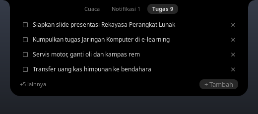<br><sub>Full list with “+N more”</sub></td>
  </tr>
  <tr>
    <td align="center">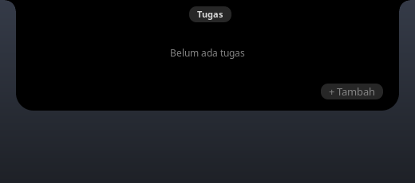<br><sub>Empty</sub></td>
    <td></td>
  </tr>
  <tr><th colspan="2">Shortcuts</th></tr>
  <tr>
    <td align="center">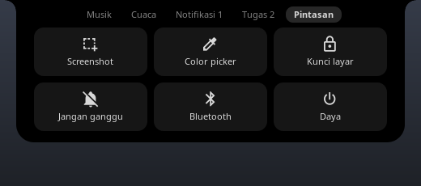<br><sub>Shortcuts</sub></td>
    <td align="center">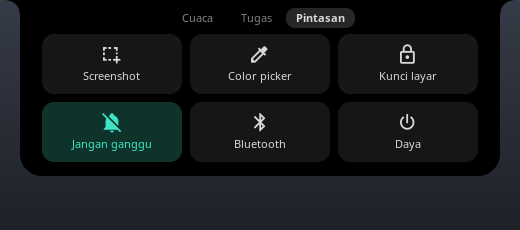<br><sub>Do Not Disturb on</sub></td>
  </tr>
</table>

### Compact pill

<table>
  <tr>
    <td align="center">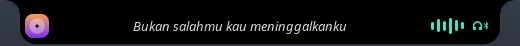<br><sub>Music with lyrics and visualizer</sub></td>
    <td align="center">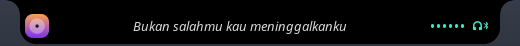<br><sub>Paused</sub></td>
  </tr>
  <tr>
    <td align="center">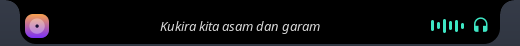<br><sub>Wired headphones</sub></td>
    <td align="center">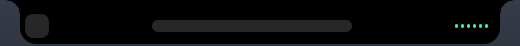<br><sub>Loading between tracks</sub></td>
  </tr>
  <tr>
    <td align="center">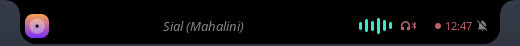<br><sub>Activity indicators</sub></td>
    <td align="center">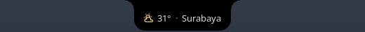<br><sub>Idle with weather</sub></td>
  </tr>
  <tr>
    <td align="center"><br><sub>Notification</sub></td>
    <td align="center">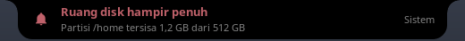<br><sub>Critical notification</sub></td>
  </tr>
</table>

### Alerts

<details>
<summary>Show all 14 alerts</summary>

<table>
  <tr>
    <td align="center">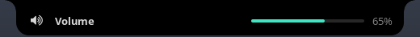<br><sub>Volume</sub></td>
    <td align="center">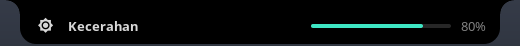<br><sub>Brightness</sub></td>
  </tr>
  <tr>
    <td align="center"><br><sub>Microphone muted</sub></td>
    <td align="center">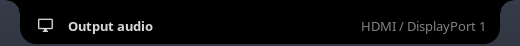<br><sub>Audio output switch</sub></td>
  </tr>
  <tr>
    <td align="center">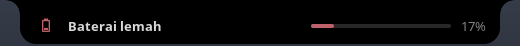<br><sub>Low battery</sub></td>
    <td align="center">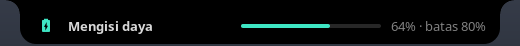<br><sub>Charging</sub></td>
  </tr>
  <tr>
    <td align="center">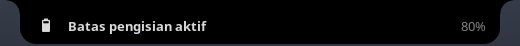<br><sub>Battery conservation mode</sub></td>
    <td align="center">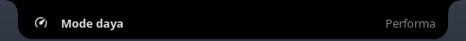<br><sub>Power profile</sub></td>
  </tr>
  <tr>
    <td align="center">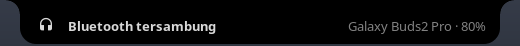<br><sub>Bluetooth</sub></td>
    <td align="center">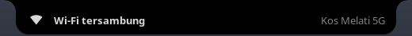<br><sub>Wi-Fi</sub></td>
  </tr>
  <tr>
    <td align="center">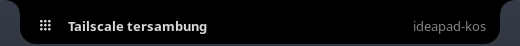<br><sub>VPN</sub></td>
    <td align="center">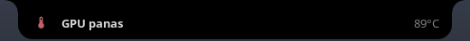<br><sub>Temperature</sub></td>
  </tr>
  <tr>
    <td align="center"><br><sub>Caps Lock</sub></td>
    <td align="center">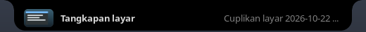<br><sub>Screenshot with thumbnail</sub></td>
  </tr>
</table>

</details>

## Install

Requires an Openbox session on X11 with eww 0.5 and dunst.

```bash
git clone https://github.com/ardzz/openbox-island.git && cd openbox-island
sudo pacman -S --needed playerctl jq curl xdotool xorg-xprop xorg-xrandr cava pipewire-audio libpulse inotify-tools python dbus light upower networkmanager
ln -s "$PWD/eww" ~/.config/eww-island
ln -s "$PWD/openbox/island.sh" ~/.config/openbox/island.sh
```

The visualizer also needs an active PipeWire session with `pipewire-pulse`.

**Start and stop**

```bash
~/.config/openbox/island.sh        # start (or restart) the island
~/.config/openbox/island.sh stop   # stop only the island daemon; safe to repeat
```

`openbox/eww.sh` from openbox-omp starts the island automatically every time the eww bar opens, including theme switches.

Full setup is in [docs/konfigurasi.md](docs/konfigurasi.md). It covers optional dependencies, the picom shadow rule, bar palette, player priority, ytm-player login, shortcuts, dunst integration, weather location and environment variables. The docs are in Indonesian for now; English versions are coming.

## Architecture

The island is a separate eww configuration (`~/.config/eww-island`) with two windows: the `island` pill and the `island-expanded` card. Data flows from **listeners → eww variables → yuck**: each `deflisten` runs one script that prints a JSON line per change, and widgets render those variables. User actions call scripts that update state and signal the listeners through FIFOs or `eww update`. Shared shell framework lives in `eww/scripts/lib/`: `core`, `store` (locked atomic JSON), `paged` (scrolling windows), `listener` (FIFO-driven loops) and `monitor` (event monitors and workers). Tabs come from a numbered registry in `eww/scripts/lib/tabs/`, and `tools/` holds the lint gate, preview renderer and showcase generator.

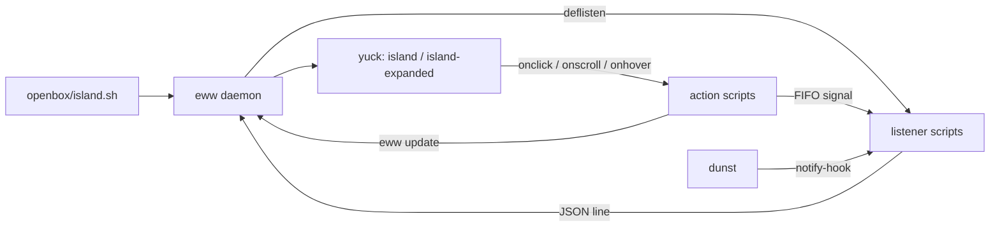

Details, area contracts and recipes for adding a tab, alert or listener: [docs/architecture.md](docs/architecture.md) (Indonesian).

## Development

```bash
bats -r tests/                                          # 442 bats tests
python3 -m unittest discover -s tests -p 'test_*.py'    # 65 Python tests
tools/check                                             # file-size gate + shellcheck + py_compile
```

`tools/check` warns above 200 lines and fails above 300 lines per tracked file in `eww/`, `openbox/`, `tools/` and `tests/`, runs `shellcheck` on bash scripts and `py_compile` on Python. CI runs all three on every push and pull request.

```bash
tools/preview eww tools/samples/card-todo.vars /tmp/card-todo.png   # render one window from a sample
tools/showcase docs/assets                                          # regenerate the gallery and demo.gif
```

## Documentation

| Page | Contents | Language |
| --- | --- | --- |
| [Features](docs/fitur.md) | Pill and card, tabs, music, visualizer, lyrics, alerts, notifications, indicators, weather, to-do, shortcuts | Indonesian |
| [Configuration](docs/konfigurasi.md) | Dependencies, start/stop, picom, palette, players, dunst integration, weather location, environment variables | Indonesian |
| [Debugging and tests](docs/debug.md) | Running tests and previews, logs and runtime state, known limitations, troubleshooting | Indonesian |
| [Architecture](docs/architecture.md) | Data flow, folder layout, shell framework, area contracts, recipes | Indonesian |

## License

[MIT](LICENSE) © 2026 Naufal Reky Ardhana
