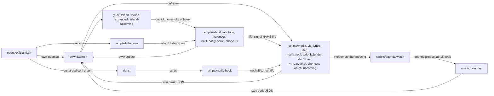

# Arsitektur openbox-island

Panduan untuk mengubah atau menambah fitur. Nama fungsi, variabel, dan path ditulis persis seperti di kode.

## 1. Ringkasan

Island adalah konfigurasi eww terpisah (`~/.config/eww-island`) dengan tiga jendela di monitor 0: dua menempel di tepi atas tengah dan satu di pojok kiri atas:

| Jendela | File | Ukuran | Isi |
|---|---|---|---|
| `island` | `eww/yuck/windows/island.yuck` | 508×44 | pill ringkas: `stack` berisi `pill-idle`, `pill-media`, `pill-alert`, `pill-notify` |
| `island-expanded` | `eww/yuck/windows/expanded.yuck` | 508×218 | kartu bertab (`tab-card`) di dalam `revealer` slidedown |
| `island-upcoming` | `eww/yuck/windows/upcoming.yuck` | shrink-wrap ×44 | pill kiri: rapat yang perlu diperhatikan dan deadline Tugas terdekat |

`scripts/island` membuka/menutup `island-expanded` (hover, `auto`, `dismiss`) dan mengatur `island_reveal` serta `island_tab`.

Alur data: **listener → variabel eww → yuck**. Setiap `deflisten` di `eww/yuck/vars.yuck` menjalankan satu skrip yang mencetak satu baris JSON per perubahan; widget membaca variabel itu. Aksi pengguna (`:onclick`, `:onscroll`, `:onhover`) memanggil skrip yang mengubah state lalu memberi tahu listener lewat FIFO (`fifo_signal`) atau langsung `eww update`.



- `openbox/island.sh`: menghentikan daemon lama, menulis `_colors.scss`, menjalankan `eww daemon`, membuka `island` lalu `island-upcoming`, menjalankan `scripts/fullscreen DAEMON_PID`, memasang `eww/dunst-osd.conf` ke `dunstrc.d`. `island.sh stop` menghentikan semuanya.
- `scripts/fullscreen` bukan deflisten: eww menghentikan deflisten yang variabelnya tidak dipakai jendela terbuka, padahal watcher ini justru menutup kedua jendela.
- `scripts/notify-hook` dijalankan dunst untuk tiap notifikasi; ia hanya mengirim baris ke `notify.fifo` dan `@refresh` ke `notif.fifo`.
- `scripts/agenda watch` mengambil feed iCal dan menulis `$ISLAND_STATE/agenda.json` setiap 15 detik; `scripts/kalender` membaca data itu untuk daftar, scroll, dan Join. Produsen berjalan sebagai monitor sumber alert `meeting`, bukan deflisten khusus kartu: deflisten yang hanya dipakai kartu berhenti saat kartu ditutup, padahal pengingat harus tetap berjalan.
- `scripts/upcoming` (deflisten pill kiri) membaca `$ISLAND_STATE/agenda.json` dan berkas Tugas yang sama setiap `ISLAND_UPCOMING_TICK` detik, lalu mencetak satu baris JSON hanya bila isi pill berubah.
- State runtime ada di `$ISLAND_STATE` (`$XDG_RUNTIME_DIR/eww-island`): FIFO `NAME.fifo`, lock, cache.

## 2. Struktur folder

```
openbox/island.sh          launcher: daemon, jendela island, fullscreen watcher, drop-in dunst
eww/eww.yuck               hanya include, urutan: vars → widgets → pill → tabs/<id> → tabs.yuck → windows
eww/eww.scss               hanya @import partial scss/_*.scss
eww/yuck/vars.yuck         semua deflisten/defvar/defpoll (satu baris per deflisten)
eww/yuck/widgets/          widget bersama: cover, skeleton, equalizer, indicators, thumb, tab, list-page
eww/yuck/pill/             halaman pill ringkas: idle, media, alert, notify
eww/yuck/tabs/<id>.yuck    satu halaman tab: page-<id>
eww/yuck/tabs.yuck         tab-header (chip) dan tab-card (halaman), urutan sama dengan lib/tabs
eww/yuck/windows/          defwindow island dan island-expanded
eww/scss/_*.scss           gaya per area (lihat peta di §4.5)
eww/scripts/<nama>         entry point: deflisten atau perintah dari yuck
eww/scripts/lib/*.sh       framework bersama (core, store, paged, listener, monitor)
eww/scripts/lib/<area>/    modul per area: alert, status, notify, tabs, viz, weather, media, ytm
eww/scripts/lyrics         entry Python; logika di eww/scripts/lyrics_pkg/ (sources/: lrclib, netease, ytmusic)
eww/scripts/agenda_pkg/    produsen kalender: config, fetch/cache iCal, recurring events, render JSON
eww/{players,shortcuts}    konfigurasi pengguna; cava.conf, dunst-osd.conf, _colors.scss
tools/check                gerbang ukuran file, shellcheck, py_compile
tools/preview              render satu jendela dari sampel ke PNG; sampel di tools/samples/*.vars
tools/showcase             semua sampel ke docs/assets/screenshots/*.png plus demo.gif (ffmpeg x11grab)
tools/lib/preview.sh       salinan config beku + daemon privat, dipakai preview dan showcase
tests/<area>/              tes bats per area (common.bash bersama); tests/lib/ untuk framework; tests/lyrics/ Python
```

## 3. Framework `eww/scripts/lib/`

Semua file di-`source`, tidak dieksekusi. `core.sh` selalu pertama; sisanya "source after core.sh".

### 3.1 `core.sh`

| Nama | Arti |
|---|---|
| `ISLAND_STATE`, `ISLAND_CFG` | dir runtime; dir config eww tempat file ini berada |
| `island_eww ARGS...` | `eww --config "$ISLAND_CFG"` tanpa mewariskan fd 9 (lock) |
| `require TOOL...` | return 127 dan isi `MISSING_DEP` dengan tool pertama yang hilang |
| `run_forever FN [ARGS...]` | ulangi FN selamanya; rc 127 → log sekali, tunggu `OB_RETRY_MISSING` (5 s); lainnya → `OB_RETRY_RECONNECT` (1 s) |
| `emit_dedup` | salin stdin ke stdout, buang baris yang sama dengan sebelumnya |
| `poll_sleep SECONDS` | sleep tanpa fork (read dengan timeout pada pipe kosong) |
| `seconds_us SECONDS` | detik desimal → mikrodetik integer |
| `fifo_signal NAME LINE` | tulis LINE ke `$ISLAND_STATE/NAME.fifo` bila ada; tidak pernah blok |
| `notify_signal LINE`, `notif_signal LINE` | `fifo_signal notify`/`notif` |
| `fmt_time SECONDS` | `m:ss`, atau `h:mm:ss` mulai satu jam |

```bash
main() { run_forever stream | emit_dedup; }   # pola scripts/media dan scripts/weather
```

### 3.2 `store.sh`: file JSON terkunci dan diganti atomik

| Nama | Arti |
|---|---|
| `STORE_VALID_JQ` | opsional; ekspresi jq yang harus menghasilkan tepat `true`, selain itu file dianggap korup |
| `store_valid FILE` | cetak JSON FILE (compact) bila berisi tepat satu nilai valid |
| `store_read FILE DEFAULT_JSON` | isi FILE, atau DEFAULT_JSON bila hilang/korup; tanpa lock |
| `store_update FILE DEFAULT_JSON JQ_FILTER [JQ ARGS...]` | flock `FILE.lock`, terapkan filter, ganti lewat rename. File korup disimpan sebagai `FILE.corrupt`. Gagal tanpa menyimpan bila filter error atau menghasilkan `null`/`false`/bukan satu nilai |

```bash
STORE_VALID_JQ='type == "object" and (.items | type) == "array"'
store_update "$FILE" "$EMPTY" '.items += [{id: $id}]' --argjson id 3 && fifo_signal todo '@refresh'
doc=$(store_read "$FILE" "$EMPTY")
```

### 3.3 `paged.sh`: jendela ROWS item

- `PAGED_JQ`: filter jq dengan variabel `$offset` dan `$rows`; hasil `{rows, more, offset}`, offset di-clamp ke `[0, max(0, n - ROWS)]`, `more` = jumlah item setelah jendela. Disisipkan ke filter render yang lebih besar (`scripts/todo`, `scripts/notif`).
- `paged ITEMS_JSON OFFSET ROWS`: pembungkus jq untuk satu daftar.

```bash
RENDER_JQ='(.items | '"$PAGED_JQ"') as $page | {rows: $page.rows, more: $page.more, offset: $page.offset}'
jq -c --argjson offset "$offset" --argjson rows "$ROWS" "$RENDER_JQ" <<< "$doc"
```

### 3.4 `listener.sh`: loop deflisten berbasis FIFO

`listen NAME RENDER_FN HANDLE_FN` membuat `$ISLAND_STATE/NAME.fifo`, mencetak output RENDER_FN saat mulai dan setiap kali berubah, lalu tidak pernah kembali.

- Tiap baris FIFO → `HANDLE_FN LINE`. Baris dalam `LISTEN_SETTLE` detik (bawaan 0.15) setelah baris pertama dirender sekali (settle). `LISTEN_SETTLE=0` = render setiap baris.
- `listen_tick`: detik tanpa input sebelum HANDLE_FN menerima `@tick`; 0 = tidak pernah. Dibaca ulang tiap iterasi, jadi handler boleh mengubahnya. Pola muat awal: `listen_tick=0.000001`, lalu handler menyetel `listen_tick=0`, sehingga muatan pertama terjadi setelah FIFO ada dan tidak ada `@refresh` yang hilang.
- `listen_render` mencetak hanya bila RENDER_FN sukses dan output berbeda dari sebelumnya.
- **Render berjalan di subshell** (`out=$("$render_fn")`): assignment di RENDER_FN hilang. Ubah state di HANDLE_FN; RENDER_FN hanya mencetak (contoh `notif_render` mencetak `$view` yang dihitung `update`).
- **Shadowing**: handler berjalan di dalam `listen`, jadi local milik `listen` (`render_fn`, `handle_fn`, `line`, `last`, `settle_us`, `deadline`, `active`, `wake`, `tick_seen`, `tick_us`, `remaining`, `timeout`) menutupi variabel pemanggil bernama sama. Karena itu `scripts/notif` memakai `refresh_delay_us`/`tick_every_us`.

```bash
todo_render() { jq -c --argjson offset "$offset" --argjson rows "$ROWS" "$RENDER_JQ" <<< "$doc"; }
todo_handle() { case $1 in '@refresh'|'@tick') load ;; '@scroll 1') scroll 1 ;; esac; listen_tick=0; }
listen_tick=0.000001
LISTEN_SETTLE=0 listen todo todo_render todo_handle
```

### 3.5 `monitor.sh`: monitor event dan worker

| Nama | Arti |
|---|---|
| `monitor_run HANDLER CMD...` | jalankan CMD, kirim tiap baris ke HANDLER sampai CMD selesai |
| `monitor_start` | opsional, nama fungsi yang dipanggil setelah CMD berjalan, sebelum baris pertama: tempat snapshot agar perubahan di antaranya tidak terlewat |
| `monitor_pid` | PID CMD yang berjalan, kosong di luar run; matikan dari trap EXIT worker |
| `workers_start FN...` | jalankan tiap FN di background dengan stdout pemanggil; PID di `worker_pids` |
| `workers_stop` | TERM lalu wait setiap worker |

```bash
monitor_start=dnd_snapshot run_forever monitor_run dnd_event dbus-monitor --session "${DND_MATCH[@]}"
workers_start audio_worker camera_worker >&"$events"; trap workers_stop EXIT
```

## 4. Kontrak area

### 4.1 Sumber alert (`scripts/alert`, `lib/alert/`)

`ALERT_SOURCES` di `scripts/alert` = urutan start worker; tiap NAME punya `lib/alert/NAME.sh`. `source_worker` (`lib/alert/worker.sh`) menjalankan kontraknya:

| Fungsi | Wajib | Arti |
|---|---|---|
| `NAME_init` | tidak | discovery; non-zero menonaktifkan sumber |
| `NAME_snapshot` | ya | sampel state, cetak `alert_json` bila berubah; sampel pertama baseline senyap |
| `NAME_monitor` + `NAME_event LINE` | salah satu | cetak perintah monitor (tiap kata diakhiri NUL) + tangani satu baris |
| `NAME_interval` | salah satu | cetak periode polling (detik) |

Helper: `alert_skip REASON` (catat di stderr lalu gagal), `alert_need TOOL...`, `alert_json KIND ICON TEXT VALUE LEVEL [IMAGE_PATH]`, `level_icon LEVEL LOW MID HIGH` (`lib/alert/common.sh`). Kind `volume|mic|brightness|capslock` bertahan `ISLAND_HUD_SECONDS` (1.5), lainnya `ISLAND_ALERT_SECONDS` (3). Pill memberi kelas `alert-${alert.kind}`.

### 4.2 Sumber status (`scripts/status`, `lib/status/`)

`mic`, `camera`, `dnd`, `headphone`. Tiap sumber mencetak `{"source":...,"active":...,"apps":...}` lewat `<src>_snapshot`, `<src>_event LINE`, `<src>_idle` (dipakai bila tool hilang). Worker dibuat dengan `source_worker SOURCE TOOL... -- CMD...` (`audio_worker`, `camera_worker`, `dnd_worker`, `bluez_worker`); `main` menggabungkan dan baru mencetak setelah keempat sumber (mic, camera, dnd, headphone) melapor.

### 4.3 Registry tab

- Skrip: `eww/scripts/lib/tabs/NN-<id>.sh` mendefinisikan `tab_<id>_available` (sukses = tab ditawarkan). Urutan header = urutan numerik NN. `scripts/tab` (`resolve`, `select`, `next`/`prev`/`up`/`down`) membacanya ke `TABS`.
- UI: `eww/yuck/tabs/<id>.yuck` berisi `page-<id>`; di `eww/yuck/tabs.yuck` satu `tab-chip` di `tab-header` dan satu `tab-page` di `tab-card`; satu `include` di `eww/eww.yuck`.

| Tab | Registry | Tersedia bila |
|---|---|---|
| `musik` | `10-musik.sh` | `media.json` berstatus playing/paused/loading |
| `cuaca` | `20-cuaca.sh` | `weather.ok` |
| `notif` | `30-notif.sh` | riwayat tidak kosong |
| `tugas` | `40-tugas.sh` | `todo.fifo` ada |
| `pintasan` | `50-pintasan.sh` | `scripts/shortcuts list` punya tombol |

### 4.4 Widget bersama (`eww/yuck/widgets/`)

| Widget | Parameter | Pakai untuk |
|---|---|---|
| `list-page` | `onscroll more`; child 0 = baris, child 1 = aksi footer | daftar berhalaman (notif, tugas) |
| `thumb` | `kind image icon` | gambar atau ikon; kelas `KIND-thumb`/`KIND-icon` |
| `tab-chip` / `tab-page` | `id label available` / `id` | header dan isi tab |
| `skeleton` | `class width` | placeholder teks yang sedang dimuat |
| `cover` | `size` | cover art `media.art` |
| `equalizer`, `indicators` | – | bar `viz`; titik rec/mic/kamera/DND |

### 4.5 Peta SCSS (`eww/scss/`)

| Partial | Isi |
|---|---|
| `_tokens` | `$island-bg`, `$island-accent`, `$island-track`, `$red`, `$muted`, `$ear` |
| `_base`, `_pill` | dasar; notch, ear, ukuran halaman pill, indikator |
| `_alert`, `_notify`, `_weather`, `_music` | per area (pill dan tab) |
| `_components` | cover, skeleton, footer `list-more`/`list-action` |
| `_card`, `_notif`, `_todo`, `_shortcuts` | kartu expanded dan tab-tabnya |

Partial baru: buat `eww/scss/_<area>.scss`, tambah `@import "scss/<area>";` di `eww/eww.scss`.

## 5. Resep

Nama `jadwal`, `fan`, dan `catatan` di bawah hanya contoh.

### 5.1 Menambah tab baru

1. Registry `eww/scripts/lib/tabs/60-jadwal.sh`:
   ```bash
   #!/usr/bin/env bash
   # Jadwal: the schedule listener has at least one item.
   tab_jadwal_available() { [[ $(island_eww get jadwal 2>/dev/null | jq -r '.total // 0' 2>/dev/null) != 0 ]]; }
   ```
2. Halaman `eww/yuck/tabs/jadwal.yuck`, lalu `(include "./yuck/tabs/jadwal.yuck")` sebelum `tabs.yuck` di `eww/eww.yuck`:
   ```lisp
   (defwidget page-jadwal []
     (list-page :onscroll "${EWW_CONFIG_DIR}/scripts/jadwal scroll {} &"
                :more {jadwal.more > 0 ? "+${jadwal.more} lainnya" : ""}
       (box :orientation "v" :space-evenly false :spacing 2
         (for row in {jadwal.rows} (label :class "jadwal-row" :xalign 0 :text {row.text})))
       (box)))
   ```
3. `eww/yuck/tabs.yuck`, pada posisi yang sama dengan NN:
   ```lisp
   (tab-chip :id "jadwal" :label "Jadwal" :available {jadwal.total > 0})   ; di tab-header
   (tab-page :id "jadwal" (page-jadwal))                                   ; di tab-card
   ```
   Tambah tes di `tests/tab/registry.bats` dan sampel `tools/samples/card-jadwal.vars` (`window=island-expanded`, `tab=jadwal`).

### 5.2 Menambah sumber alert baru

1. `eww/scripts/lib/alert/fan.sh` (polling, pola `conservation.sh`):
   ```bash
   #!/usr/bin/env bash
   # Alert source: fan mode changes (sysfs). Source it; do not execute.
   ICON_FAN=$'\U000F0210'
   fan_init() { [[ -r ${ISLAND_FAN:-/sys/devices/platform/fan/mode} ]] || alert_skip 'mode kipas tidak ditemukan'; }
   fan_interval() { printf '%s' "${ISLAND_FAN_INTERVAL:-5}"; }
   fan_snapshot() {
     local mode=''
     IFS= read -r mode 2>/dev/null < "${ISLAND_FAN:-/sys/devices/platform/fan/mode}" || return 0
     if [[ -n ${fan_state:-} && $mode != "$fan_state" ]]; then alert_json fan "$ICON_FAN" 'Mode kipas' "$mode" -1; fi
     fan_state=$mode
   }
   ```
   Untuk sumber berbasis event, ganti `fan_interval` dengan `fan_monitor() { printf '%s\0' CMD ARG...; }` dan `fan_event()` (pola `bluetooth.sh`).
2. Daftarkan di `ALERT_SOURCES` pada `eww/scripts/alert`: `(... conservation vpn fan)`.
3. Tes `tests/alert/fan.bats` (`load helpers`, panggil `fan_snapshot` berulang, cek JSON); gaya opsional `.alert-fan` di `eww/scss/_alert.scss`.

### 5.3 Menambah listener baru (listen + store/paged)

1. `eww/scripts/catatan` (pola `scripts/todo`):
   ```bash
   #!/usr/bin/env bash
   # catatan: deflisten printing saved notes, one JSON object per line. catatan scroll up|down
   DIR="$(cd "$(dirname "${BASH_SOURCE[0]}")" && pwd)"
   source "$DIR/lib/core.sh"; source "$DIR/lib/store.sh"
   source "$DIR/lib/listener.sh"; source "$DIR/lib/paged.sh"
   FILE="${XDG_DATA_HOME:-$HOME/.local/share}/eww-island/catatan.json" ROWS=4 EMPTY='{"items":[]}'
   RENDER_JQ='(.items | '"$PAGED_JQ"') as $page | {total: (.items | length), rows: $page.rows, more: $page.more}'
   load() { doc=$(store_read "$FILE" "$EMPTY"); total=$(jq '.items | length' <<< "$doc"); }
   # scroll STEP: move the window by STEP, clamped like PAGED_JQ.
   scroll() { local top=$(( total > ROWS ? total - ROWS : 0 )); offset=$((offset + $1)); ((offset >= 0)) || offset=0; ((offset <= top)) || offset=$top; }
   catatan_render() { jq -c --argjson offset "$offset" --argjson rows "$ROWS" "$RENDER_JQ" <<< "$doc"; }
   catatan_handle() {
     case $1 in '@refresh'|'@tick') load ;; '@scroll -1') scroll -1 ;; '@scroll 1') scroll 1 ;; esac
     listen_tick=0
   }
   main() {
     case ${1:-} in scroll) fifo_signal catatan "@scroll $([[ $2 == up ]] && echo -1 || echo 1)"; return ;; esac
     require jq || return 127
     local doc='' total=0 offset=0
     listen_tick=0.000001
     LISTEN_SETTLE=0 listen catatan catatan_render catatan_handle
   }
   if [[ ${BASH_SOURCE[0]} == "$0" ]]; then main "$@"; fi
   ```
   Penulis memakai `store_update "$FILE" "$EMPTY" FILTER ...` lalu `fifo_signal catatan '@refresh'`.
2. Satu baris di `eww/yuck/vars.yuck` (harus satu baris agar `tools/preview` bisa membekukannya):
   ```lisp
   (deflisten catatan :initial '{"total":0,"rows":[],"more":0}' "scripts/catatan")
   ```
3. Tes `tests/catatan/` (`common.bash` + `.bats`) dan pakai variabel `catatan` di widget/tab.

## 6. Kualitas

- **Ukuran file**: target ≤200 baris, batas keras 300. `tools/check [ROOT]` memeriksa file yang di-track di `eww/ openbox/ tools/ tests/` (`.md` di luar cakupan): >200 `WARN`, >300 `FAIL`, `shellcheck -x -s bash -S warning` untuk bash, `py_compile` untuk Python. Dilewati: `*.conf`, `eww/players`, `eww/shortcuts`, gambar.
- **Tes**: `bats -r tests/`, `python -m unittest discover -s tests -p 'test_*.py'`, lalu `tools/check`. Tes mengikuti area: `tests/<area>/*.bats` dengan `common.bash`, `tests/lib/` untuk framework, `tests/tools/` untuk tools; `tests/helpers.bash` menyediakan `REPO` dan `SCRIPTS`.
- **Preview dan perbandingan piksel**: `tools/preview CONFIG_DIR SAMPLE OUT.png` menyalin config ke `/tmp`, mengganti setiap `deflisten`/`defpoll` dengan `defvar` berisi `:initial`, mematikan animasi, lalu merender jendela 300px di bawah tepi atas pada `DISPLAY` aktif. Sampel `tools/samples/*.vars`: `window=island|island-expanded`, opsional `tab=<id>`, lalu `var=<json>`; `@ASSETS@` = `tools/samples/assets/`. Alur yang disarankan: render baseline sebelum perubahan, render ulang sesudahnya, bandingkan dengan `compare` ImageMagick (yang juga menyediakan `import` yang dipakai preview):
  ```bash
  mkdir -p ~/.cache/island-baseline /tmp/island-new
  for f in tools/samples/*.vars; do tools/preview eww "$f" ~/.cache/island-baseline/"$(basename "$f" .vars)".png; done
  # ...ubah kode, lalu render ulang ke /tmp/island-new dengan loop yang sama...
  compare -metric AE ~/.cache/island-baseline/card-todo.png /tmp/island-new/card-todo.png /tmp/diff.png
  ```
- **Aset README**: `tools/showcase docs/assets` merender setiap sampel ke `docs/assets/screenshots/<nama>.png` (PNG sampel yang sudah tidak ada dihapus), lalu menjalankan satu daemon dengan animasi menyala dan merekam skenario ±12 detik (pill musik, kartu terbuka dan berpindah tab, alert volume, notifikasi) dari wilayah 520×230 di y=300 dengan `ffmpeg -f x11grab` menjadi `docs/assets/demo.gif`. Nilai demo diambil dari sampel (`card-music-ytm`, `card-notif`, `card-todo`, `card-shortcuts-dnd`, `pill-notify`). Latar belakang render diatur `PREVIEW_BACKDROP` (warna atau `linear-gradient(...)` CSS): `tools/preview` memakai `#808080` agar baseline perbandingan piksel tetap sama, `tools/showcase` memakai gradien gelap mirip desktop. Jangan gerakkan mouse selama perekaman; tooltip disembunyikan dan `scripts/island` di salinan diganti no-op agar pointer di atas wilayah itu tidak mengubah gambar.

### Quirk eww 0.5
| Quirk | Akibat di proyek |
|---|---|
| `stack :selected` yang sudah terisi saat jendela dibangun tidak menampilkan halaman | `tools/preview` membuka jendela dulu, baru `eww update` |
| `:visible` tetap tersembunyi di halaman stack yang belum pernah tampil | pakai `revealer :transition "none"` (`thumb`, `tab-chip`, `tab-page`) |
| Geometri jendela statis | `island` 508×44, `island-expanded` 508×218; isi tab harus muat (mis. 4 baris + footer di `notif`) |
| `onscroll` hanya melaporkan scroll vertikal | ganti tab dengan scroll atas/bawah di header (`scripts/tab {}`) |
| Urutan include | pertahankan urutan di `eww/eww.yuck`: vars → widgets → pill → tabs/<id> → `tabs.yuck` → windows |
| `onhover`/`onhoverlost` juga terpicu oleh pointer grab | `scripts/island` membaca posisi pointer sendiri (`hovered`) |
